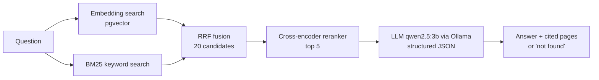

# Erasmus+ Assistant (RAG)

Ask questions about the Erasmus+ programme (studies, traineeships, youth exchanges, staff mobility, partnerships, grants) and get short answers **with page citations**. It answers from the whole EU Programme Guide, plus my university's own traineeship documents:

| Source | What it covers | Size |
|---|---|---|
| Erasmus+ Programme Guide 2027 (EU) | rules, grant ranges, durations, eligibility | 466 pages |
| Istanbul Gelişim University (IGU) step-by-step guide | what the student has to do before, during and after the traineeship | 9 pages |
| IGU orientation slides | grant amounts, documents, deadlines (slides are images, read with OCR) | 20 slides |

**Live demo:** [huggingface.co/spaces/rabiaozers/erasmus-assistant](https://huggingface.co/spaces/rabiaozers/erasmus-assistant) (a chat page I designed in pastel pixel-art style; the free server sleeps when idle, so the first visit takes a minute)

<!-- demo GIF:  -->

Locally everything runs on a laptop: PostgreSQL + pgvector in Docker and a 3B-parameter LLM with Ollama on a 4 GB GPU. The public demo keeps the chunks in memory and uses a 120B model through Groq's free API.



## Example

```
POST /ask  {"question": "How much monthly grant does IGU pay for a traineeship in Italy?"}

{"found": true, "answer": "750 EUR",
 "sources": [{"source": "igu-slides", "page": 15}], ...}

POST /ask  {"question": "Can I have a relationship during Erasmus?"}

{"found": false, "answer": "I could not find this in the Erasmus+ Programme Guide or the IGU documents.", "sources": []}
```

## How I worked

**1. Evaluation set first.** Before building anything, I wrote 34 questions (most of them things I wanted to know before my own traineeship) and looked up the correct page for each in the source PDFs ([eval/questions.csv](eval/questions.csv)). 31 have an answer; 3 are not covered by the documents and the system should say so.

**2. Retrieval: measured, diagnosed, improved.** `recall@k` = the share of questions where a correct page is among the top-k chunks.

Chunking (first 22 questions, Programme Guide only):

| Chunks | recall@1 | recall@3 | recall@5 |
|---|---|---|---|
| one chunk per page | 0.23 | 0.36 | 0.41 |
| 150 words, 30-word overlap | 0.27 | 0.50 | 0.59 |

Most misses with page-level chunks were the *neighbouring* page: the embedding model (all-MiniLM-L6-v2) only reads the first 256 tokens of a ~600-token page, and one vector for a page full of different topics matches none of them well.

Search method (final set, 31 answerable questions, 3 sources):

| Method | recall@1 | recall@3 | recall@5 |
|---|---|---|---|
| embedding (pgvector) | 0.19 | 0.39 | 0.48 |
| BM25 (with stemming) | 0.32 | 0.45 | 0.61 |
| hybrid: embedding + BM25 with Reciprocal Rank Fusion | 0.19 | 0.58 | 0.68 |
| **hybrid + cross-encoder reranker** | **0.35** | **0.68** | **0.71** |

What I learned along the way:
- PostgreSQL's `ts_rank` has no IDF, so "Erasmus" (on every page) outweighed "visa" (the actual topic). BM25 fixed this, but only after adding stemming and stop words: without them BM25 alone scored 0.27.
- The embedding search almost never found the small IGU documents (2 of 9 questions): the 466-page guide has glossary pages about "grant agreements" and "bank accounts" that look similar in meaning. Keyword search finds the specific words (Ziraat, orientation), so hybrid search helps most here.
- RRF combines ranks instead of scores, so it needs no weight to tune. With only 31 questions, tuning a weight on the evaluation set would have overfitted it.
- The reranker almost doubled recall@1 (0.19 → 0.35); it re-orders the 20 hybrid candidates by reading question and chunk together.

**3. Generation.** The LLM gets the top 5 chunks as numbered passages and must return JSON with a Pydantic schema (`answer`, `citations`, `found`); citation numbers are mapped back to source and page in code. Results on all 34 questions ([eval/](eval/)):

| | llama3.2:3b (local) | qwen2.5:3b (local, chosen) | gpt-oss-120b (Groq API) |
|---|---|---|---|
| says "not found" for the 3 uncovered questions | 3/3 | 3/3 | 3/3 |
| cites a correct page (31 answerable) | 15/31 | 16/31 | 15/31 |
| all key numbers of the expected answer present | 6/20 | 7/20 | 8/20 |
| time per answer | 9.6 s (GTX 1650) | 8.7 s (GTX 1650) | ~2.5 s |

**A 40x larger model did not cite the right page more often.** This was the most useful result of the project: the limit is retrieval, not the LLM. With recall@5 = 0.71, about 9 of 31 questions never get the right page, and on those every model either says "not found" or answers from a wrong passage. For example, all three models answered the application-deadline question with another programme's date (11 instead of 18 February), and the grant question with the Erasmus Mundus scholarship (1,400 EUR), because those were the passages they were given. The 120B model writes more complete answers (it lists all four return documents, and it even corrected an extraction typo, "Zraat" to "Ziraat"), which the strict key-number check only partly rewards.

For the local setup I kept Qwen: same quality as Llama, a bit faster, and identical answers when run twice at temperature 0. The public demo uses gpt-oss-120b through Groq's free tier, because the free demo server has no GPU.

Two fixes came from reading the answers, not from the metrics:
- Sometimes the flag and the text disagreed (`found: true` with the answer "no answer found"). I moved `found` to the end of the schema, so the model writes the answer before deciding, and the code now trusts the text when it says "not found".
- When the model said "not found" it sometimes still wrote a misleading explanation, so the code replaces the text with a fixed message.

## Known weaknesses

- **Retrieval caps everything.** recall@5 is 0.71, so for about 9 of 31 questions the right page never reaches the LLM. Questions whose answer is spread over several pages (how the grant is calculated) or sits in a table (travel distance bands) are the hardest.
- **A 3B model misreads tables and mixes up programmes**, e.g. it answered "up to 24 months" for a study period (correct: 2-12 months). A larger model would help but does not fit in 4 GB of VRAM.
- **Text extraction noise:** the IGU slides are images, and tesseract misread some numbers in the travel table. The IGU step-by-step PDF loses some letters on extraction ("Zraat", "vsa" instead of "Ziraat", "visa"), which also hurts keyword search for those words.
- **Small evaluation set:** with 31 questions one question is 3 percentage points, so small differences are not significant.
- The key-number check is strict (every number of the expected answer must appear) and some correct but shorter answers fail it; I also read the answers by hand.

## How to run

Requirements: Docker Desktop, [Ollama](https://ollama.com), Python 3.12+.

```bash
# 1. Documents (not in the repository)
#    data/programme-guide.pdf       from https://erasmus-plus.ec.europa.eu/programme-guide/erasmusplus-programme-guide
#    data/igu-application-steps.pdf and data/igu-documents-ocr.json  (IGU documents, available to IGU students)

# 2. Database and LLM
docker compose up -d db
ollama pull qwen2.5:3b

# 3. Index the documents and evaluate
pip install -r requirements.txt
python ingest.py            # ~2 min on CPU: 1,861 chunks into pgvector
python evaluate.py          # retrieval recall@k for every method
python eval_answers.py      # answers to all 34 questions -> eval/answers_<model>.csv

# 4. Chat page at http://localhost:8000 (API docs at /docs)
uvicorn app:app
#    or everything in Docker (Ollama stays on the host for the GPU):
docker compose up --build
```

## Files

| File | What it does |
|---|---|
| `chunking.py` | reads the PDFs / OCR text and splits pages into 150-word chunks with page numbers |
| `ingest.py` | embeds every chunk and stores it in PostgreSQL |
| `db.py` | table schema, pgvector search, PostgreSQL full-text search |
| `retrieval.py` | BM25, Reciprocal Rank Fusion, reranker |
| `rag.py` | prompt, Ollama call with a JSON schema, citations |
| `app.py` | FastAPI: chat page at `/`, `POST /ask`, `GET /health` |
| `web/index.html` | the chat page: HTML, CSS and JavaScript, with pixel-art sprites drawn in code |
| `memory_store.py`, `export_index.py` | the demo keeps chunks and embeddings in memory instead of PostgreSQL |
| `space/`, `deploy_space.py` | Dockerfile and upload script for the Hugging Face Space (Groq key stored as a Space secret) |
| `evaluate.py`, `eval_answers.py`, `metrics.py` | retrieval and answer evaluation |
| `eval/questions.csv` | 34 questions with answers and correct pages |
| `tests/` | unit tests (chunking, RRF, tokenizer, metrics), run by GitHub Actions |

The IGU documents belong to Istanbul Gelişim University's International Exchange and Cooperation Office and are not included in this repository.
